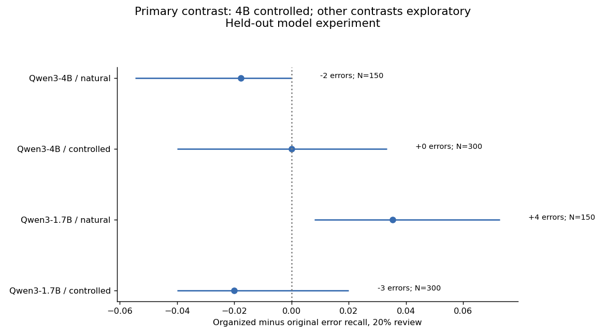

# Evidence Before Escalation

Does organizing identical evidence help an open-model auditor prioritize errors for limited review?

**Completed experiment · 24 October 2026.** [Read the study](https://xenonnn4w.me/research/evidence-before-escalation) · [Full report](reports/RESULTS.md) · [Protocol](docs/PROTOCOL.md)

## Result

At a 20% review budget, Qwen3-4B selected **41 of 150 controlled errors under either evidence layout**. The paired change in error recall was **0.0 percentage points (95% interval −4.0 to +3.3)**. This does not establish equivalence; smaller benefits or harms remain plausible.

| Auditor | Reports | Original: errors selected | Organized: errors selected | Queue size |
|---|---|---:|---:|---:|
| Qwen3-1.7B | Controlled | 31 | 28 | 60 |
| Qwen3-1.7B | Natural | 23 | 27 | 30 |
| Qwen3-4B | Controlled, primary | 41 | 41 | 60 |
| Qwen3-4B | Natural | 30 | 28 | 30 |



The layouts selected different reports even when their totals matched. The 4B auditor missed all 50 erroneous natural metric reports under both layouts. Task-level and queue-overlap plots make these failures visible.

## Experiment

- **150 test base cases**, plus 30 separate development cases; metric reporting, validation-only selection, and evaluation-ledger completeness.
- **450 test reports:** 150 real Qwen3-4B generations, 150 correct reference reports, and 150 reference reports with one controlled corruption.
- **2,700 test scores:** Qwen3-1.7B and 4B auditors × three conditions × 450 reports.
- **Conditions:** report only, original-order evidence, and the identical evidence sorted by claim field. No added answers or summaries.
- **Hardware:** one RTX 3090 24GB, BF16, batch 1. No training; optional 8B not run.
- **Analysis:** review budgets of 10%, 20%, and 40%; 2,000 paired base-case bootstrap samples stratified by family and test stratum.

Inputs are synthetic, but model generation and auditing are real inference. Natural and deliberately corrupted reports are analyzed separately. Scores are relative completion likelihoods, not calibrated probabilities.

## Reproduce

Use the Python 3.11 environment specified in `pyproject.toml` and `uv.lock`:

```bash
uv sync --frozen
uv run python -m auditbench validate-run --out results/test
uv run python -m auditbench analyze --out results/test
uv run python analysis/supplementary.py
```

Analysis uses saved scores and requires no GPU or model downloads. New inference requires the pinned model revisions and a compatible GPU environment; see [launch instructions](docs/LAUNCH.md). Frozen planning strings in the config are historical: the run manifests record actual execution and hardware.

## Files

| Path | Contents |
|---|---|
| `reports/RESULTS.md` | Methods, results, uncertainty, examples, and limitations |
| `results/test/` | Raw generations, reports, prompts, scores, manifest, and validation |
| `results/test/analysis/` | Ten figures in PNG/PDF, with source CSVs |
| `analysis/supplementary.py` | Three post-hoc descriptive diagnostics |
| `reports/independent_metric_check.json` | All 50 metric labels recomputed from raw predictions |
| `data/` | Seeded cases and pre-test freeze signatures |
| `auditbench/` | Generator, scoring, checking, validation, and core analysis |

The first seven figures follow the frozen analysis plan. Figures 8–10 were added after inspecting results; they introduce no new inference or confirmatory claims. Preparation documents and synthetic validation fixtures are historical development evidence, not experimental results.

## Limits

The deterministic checker already solves these bounded tasks, so this study does not establish that an LLM is preferable to executable checking. It uses one model family, one generator draw per case, and a designed 50% error rate in the controlled arm. No human reviewers participated; there is no measured improvement in human decisions or time saved.

